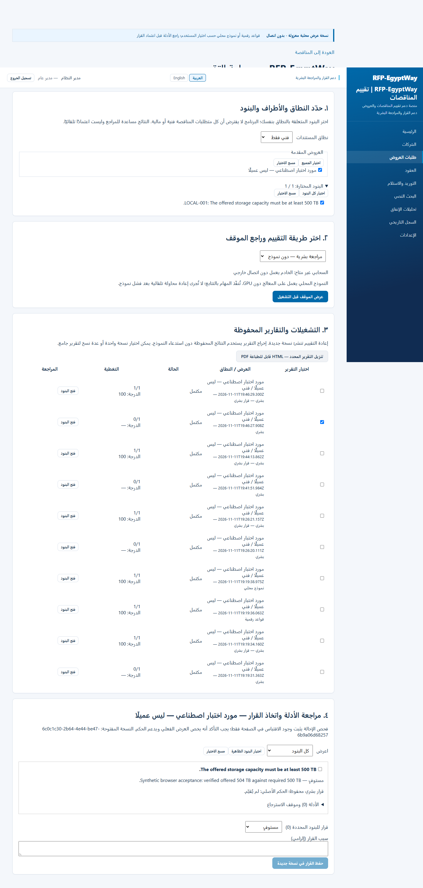

# RFP-EgyptWay

**Review supplier proposals. Trace the evidence. Keep the decision with your team.**

RFP-EgyptWay is a pilot application for evaluating technical and financial proposals against tender requirements. It helps reviewers organize the review, inspect supporting evidence, record their decisions, and produce versioned reports.

This public repository is a product showcase and documentation hub. It does not contain the proprietary application source, customer documents, credentials, or installation packages.

[Trial guide](docs/TRIAL-GUIDE.md) · [Feedback guide](docs/FEEDBACK.md) · [العربية](docs/README-AR.md)

## Pilot availability

The external pilot is **not open yet**. Operational acceptance and a Google site-security warning remain under review. No invitation should be interpreted as available until these checks are complete.

To express interest, email **mohamedramadan1313@gmail.com** with the subject **RFP-EgyptWay — Trial request**. Describe your review workflow and preferred language. Please do not attach confidential proposals or credentials.

## What the application supports

- Technical-only, financial-only, or combined review scopes.
- Selection of one or several supplier submissions and individual requirements.
- Manual review, deterministic numeric checks, and a configured local language model.
- Cloud evaluation where a deployment explicitly enables and configures it; it is not included in the external local-only pilot by default.
- Evidence references, reviewer decisions with reasons, and new versions when a review changes.
- Individual or combined HTML reports suitable for printing.
- Arabic content and review workflows. English and Arabic interface coverage is being refined during the pilot.

RFP-EgyptWay evaluates documents supplied for a review. It is not a tender-listing service or a marketplace for finding procurement opportunities.

## A typical review

1. Request a trial and receive your assigned account and operating window.
2. Sign in using the trial link supplied to you. Do not bypass browser security warnings.
3. Create a tender and add its requirements and supplier submissions.
4. Upload documents you are permitted to use. Start with public, historical, or synthetic examples.
5. Verify the extracted text and requirements before evaluating.
6. Choose the document scope, suppliers, requirements, and available engine.
7. Inspect the preview and start the evaluation. Wait for a completed run, then open its items.
8. Read the evidence and reasoning. Missing evidence is not automatically non-compliance.
9. Accept or change a decision with a reason; keep the original result and the review version.
10. Select the report versions to export and send feedback by email.

## Feedback that helps

Email **mohamedramadan1313@gmail.com**, subject **RFP-EgyptWay — Feedback**. Include the screen, steps, expected result, actual result, and approximate time. Review any support export before sharing. Do not send API keys, passwords, confidential document text, or screenshots containing sensitive information.

Tell us whether the evidence was relevant, whether the explanation supported the decision, and where the workflow was confusing. Reviewer changes are signals for investigation, not automatic proof that a model was wrong.

## Current limitations

- This is a pilot for decision support, not an autonomous procurement authority.
- Model answers can be wrong even when a quotation is genuine. Human review remains necessary.
- CPU-only inference may take several minutes per requirement.
- Synthetic acceptance tests demonstrate tested workflows; they do not establish general accuracy or production readiness.
- Trial processing is scheduled rather than available continuously.

If the project is relevant to your work, a star helps people discover it. Practical feedback and completed trials are the more useful measures of product value.

## Inside the application

The screenshots below show a synthetic acceptance example, not customer documents or an endorsement. The screen is in Arabic; the tender requirement is in English.

### Select the scope, review the run, and record a decision

### Mobile access

[View the complete mobile screenshot](images/evaluation-mobile.png). Desktop use is recommended for reviewing long documents side by side.

### Product illustration

The illustration below is promotional artwork, not a screenshot. The free trial is planned; registration of interest is open, but access remains on hold until launch checks are complete.

